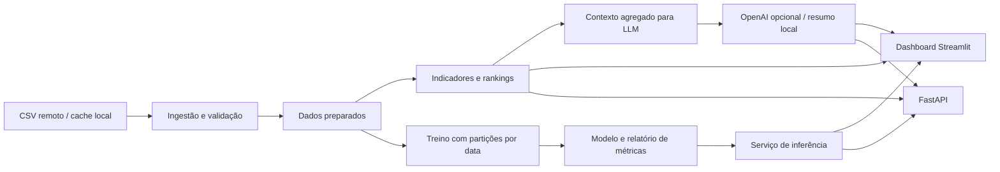

# ✈️ FlightLab

**Do notebook exploratório a um produto de dados com dashboard, machine learning e IA generativa.**

[](pyproject.toml)
[](apps/dashboard.py)
[](src/flightlab/api.py)
[](https://github.com/DiogoPacker/projetinho_mba/actions/workflows/ci.yml)

### [🚀 Abrir o dashboard ao vivo](https://flightlab-dashboard.onrender.com)

Demo hospedada no Render. No primeiro acesso após um período sem uso, o serviço pode
levar cerca de um minuto para iniciar. Depois que a aplicação abre, uma animação de
carregamento acompanha a preparação dos dados. Aguarde sem precisar atualizar a página.

[Dashboard interativo](#dashboard-interativo) · [Executar localmente](#executar-no-windows) ·
[Deploy no Render](#publicar-no-render) · [Documentação](docs/README.md) · [Evolução](docs/development.md)

## Por que este projeto existe

Uma companhia com mais voos atrasados é necessariamente a pior em pontualidade?
Como comparar rotas com volumes diferentes? O que sabemos **antes da partida** que pode
ajudar a estimar o risco de atraso?

O FlightLab parte dessas perguntas e acompanha o caminho completo: dados brutos,
qualidade, indicadores, experimento preditivo, interfaces e publicação. O foco é
demonstrar como transformar um estudo acadêmico em software utilizável e verificável.

**Escopo:** voos de Nova York em 2013. Atraso significa chegada com **15 minutos ou mais**
de atraso. A demonstração é educacional; o modelo não foi validado para operações atuais.

## O que demonstra

| Atuação | Entrega concreta |
| --- | --- |
| Analista de dados | Validação da base, definição de atraso, taxas comparáveis, filtros, rankings e exportação CSV |
| Cientista de dados | Features anteriores ao voo, regressão logística, baseline e separação temporal de treino/validação/teste |
| Engenheiro de IA | LLM com contexto agregado, configuração por ambiente, limites de entrada, timeout e testes sem chamadas pagas |
| Desenvolvedor Python | Pacote instalável, CLI, FastAPI, contratos Pydantic, testes, lint, CI e configuração Docker |

## Dashboard interativo

**Sim: a interface já está implementada em Streamlit com gráficos Plotly.**

| Aba | O que você pode fazer |
| --- | --- |
| Análise de dados | Filtrar companhia, origem e meses; comparar taxas; consultar rotas; baixar indicadores em CSV |
| Previsão de atraso | Informar um voo, estimar a probabilidade de atraso e conferir avaliação e limitações |
| Assistente | Obter resumo do recorte ou usar um LLM para interpretar as estatísticas disponíveis |
| Projeto | Entender as quatro áreas profissionais e conferir a qualidade da base |

Os gráficos permitem zoom, seleção de área e detalhes ao passar o mouse. Os filtros
atualizam os indicadores e o contexto do assistente. O simulador utiliza o modelo
salvo no treinamento, independentemente do recorte da análise.

**Demo pública:** https://flightlab-dashboard.onrender.com

**Localmente:** execute o projeto e abra http://localhost:8501.
A primeira preparação dos dados exibe uma tela de espera animada; os acessos seguintes
aproveitam o cache enquanto o processo está ativo. A retomada de uma instância Free
adormecida acontece antes dessa tela e é controlada pelo Render.

[Guia de uso do dashboard →](docs/dashboard.md)

## Resultado real do primeiro experimento

Treinamento executado com **327.346 voos válidos**, de 336.776 registros originais.
Treino, validação e teste usam períodos separados, sem compartilhar datas.

| Métrica em teste | Regressão logística | Baseline constante |
| --- | ---: | ---: |
| ROC AUC — maior é melhor | 0,5768 | 0,5000 |
| Precisão média (AP) — maior é melhor | 0,3074 | 0,2504 |
| Brier — menor é melhor | 0,1943 | 0,1880 |

O modelo tem algum poder de ordenar riscos, mas **perde para o baseline no erro de
probabilidade**. Com limiar 0,5, seu recall é apenas 4,2%. Mostrar essa limitação faz
parte do projeto: ter uma interface de previsão não torna o modelo adequado para produção.

[Relatório e interpretação do experimento →](docs/model-card.md)

## Publicar no Render

O arquivo [render.yaml](render.yaml) configura **um Web Service Python** para o dashboard.
O [script de build](scripts/render-build.sh) instala o pacote, baixa a base e treina o modelo.
O dashboard funciona sem manter outro serviço para a API.

1. Envie os arquivos deste projeto ao seu repositório no GitHub.
2. No Render, selecione **New → Blueprint** e conecte o repositório.
3. Revise o serviço `flightlab-dashboard` e confirme a criação.
4. Aguarde o build e teste a URL `onrender.com` fornecida pelo Render.
5. Adicione essa URL ao GitHub e inclua uma captura real da interface no portfólio.

A configuração usa `plan: free`, sem banco ou disco persistente. No plano gratuito,
o serviço pode suspender após 15 minutos sem tráfego e demorar para responder à próxima
visita. Confira as [limitações atuais do Render](https://render.com/docs/free).
Se a instância não comportar o uso de memória, ajuste os recursos antes de anunciar a demo.

**A demo pública deixa o LLM desativado por padrão.** Dashboard, modelo e resumo local
continuam funcionando. Chamadas pagas devem ser habilitadas apenas em um ambiente com
acesso e uso controlados.

[Passo a passo, configuração manual, API opcional e troubleshooting →](docs/deployment-render.md)

## Executar no Windows

Requer Python 3.11 ou superior; Python 3.12 é a versão usada no CI e no Docker.
Na raiz do repositório, no PowerShell:

```powershell
py -m venv .venv
.\.venv\Scripts\python.exe -m pip install -r requirements.txt
.\.venv\Scripts\flightlab.exe download
.\.venv\Scripts\flightlab.exe train
.\.venv\Scripts\python.exe -m streamlit run apps/dashboard.py
```

Dashboard: http://localhost:8501. Em outro terminal:

```powershell
.\.venv\Scripts\python.exe -m uvicorn flightlab.api:app --reload
```

API e documentação interativa: http://localhost:8000/docs.
No Linux/macOS, use `python3 -m venv .venv` e os executáveis em `.venv/bin/`.
Os dados e o modelo são gerados localmente, não baixados automaticamente ao abrir a interface.
Após atualizar dados ou treinar novamente, reinicie a API e o dashboard para limpar seus caches.

## Assistente LLM

O modo local funciona sem credencial e apresenta um resumo fixo dos filtros selecionados.
Ele não interpreta perguntas livres. Para habilitar o LLM:

1. Copie `.env.example` para `.env`.
2. Preencha `OPENAI_API_KEY` e, se necessário, `OPENAI_MODEL`.
3. Ative a opção de LLM na aba Assistente.

`FLIGHTLAB_ENABLE_LLM=false` bloqueia chamadas ao provedor, inclusive pela API.
No Render, esse bloqueio já está definido no Blueprint. Localmente, o `.env.example`
traz `true`; uma chave válida continua sendo necessária para uma chamada real.

O provedor recebe a pergunta e estatísticas agregadas, sem registros individuais.
A integração usa a Responses API da OpenAI com `store=False`; chamadas têm custo na conta
configurada. O modelo padrão é configurável. Não é necessário treinar um LLM.
O LLM explica indicadores; o modelo scikit-learn calcula a probabilidade de atraso.
O contexto cobre companhias, dez rotas com maior taxa e meses, com no mínimo 100 voos por
companhia/rota. Perguntas fora desse contexto podem não ser respondidas. As instruções
reduzem invenções, mas não garantem exatidão: confira o JSON exibido junto à resposta.

## Arquitetura



Dashboard e API compartilham os mesmos serviços Python. O dashboard chama esses serviços
diretamente e pode funcionar sem o servidor FastAPI.

```text
apps/dashboard.py          Interface Streamlit
src/flightlab/
  config.py               Caminhos, features e definição do alvo
  data.py                 Download explícito, validação, limpeza e rastreabilidade
  analytics.py            Indicadores e rankings
  model.py                Treinamento, avaliação, persistência e previsão
  assistant.py            Resumo local e integração LLM
  api.py                  Rotas REST e validação de entrada
  cli.py                  Comandos download, quality e train
scripts/render-build.sh   Instalação, download e treino no build do Render
render.yaml               Infraestrutura declarativa para a demo pública
tests/                    Testes de dados, modelo, API, assistente e interface
data/raw/                 CSV local (ignorado pelo Git)
artifacts/                Modelo local e relatório versionável
docs/                     Decisões e roteiro para apresentação
nyflights-model/           Notebook e apresentação originais preservados
decode_morse_project/     Exercício original independente preservado
```

## Metodologia e limitações

- Alvo: chegada com **15 minutos ou mais** de atraso. O notebook original usava `> 0`;
  comparações com seus gráficos precisam considerar essa mudança de definição.
- `arr_delay` é usado somente para construir o alvo e para análise descritiva.
- Preditores: companhia, origem, destino, mês, dia da semana e distância em milhas.
  Horários reais, atraso da partida e tempo real no ar não entram no modelo.
- Datas distintas ordenadas: aproximadamente 65% para treino, 17% para validação e
  18% para teste. Nenhuma data aparece em duas partições. O preprocessamento aprende
  apenas no treino; categorias novas são ignoradas pelo encoder e sinalizadas na resposta.
- Regressão logística com normalização e one-hot encoding; baseline de probabilidade
  constante igual à prevalência no treino. Limiar fixo de decisão: 0,5.
- ROC AUC, precisão média (average precision), Brier, precisão e recall são reportados
  em validação e teste. O conjunto de teste não define parâmetros ou limiares.
- Não há ajuste de hiperparâmetros ou escolha automática do melhor modelo nesta versão.
  A validação serve de diagnóstico; o desempenho modesto deve ficar visível.
- A média de `arr_delay` inclui antecipações. Rankings mostram taxas e contagens,
  com mínimo de observações; não demonstram causalidade.
- Registros sem alvo ou features válidas são excluídos. Isso inclui voos sem chegada
  registrada: o modelo não prevê cancelamentos. O relatório registra exclusões e hash do CSV.
- Há apenas um ano e não há clima ou horário programado na base original. A tendência
  por mês e a mudança de distribuição entre períodos limitam a generalização.
- Coeficientes são associações globais na regressão, não explicações causais.
- API local sem autenticação ou rate limiting. Antes de expor publicamente, adicione
  autenticação, limites de uso e observabilidade, principalmente para o endpoint pago de LLM.

## API

| Método | Rota | Função |
| --- | --- | --- |
| GET | `/health` | Processo disponível |
| GET | `/analytics?carrier=AA&month=11` | Agregados filtrados |
| GET | `/model` | Métricas, períodos, features e limitações |
| POST | `/predict` | Probabilidade de atraso ≥15 minutos |
| POST | `/assistant` | Resumo local ou resposta LLM; filtro opcional por companhia |

Exemplo de previsão pelo PowerShell:

```powershell
$flight = @{
    date = '2013-11-15'
    carrier = 'AA'
    origin = 'JFK'
    dest = 'LAX'
    distance = 2475
} | ConvertTo-Json
Invoke-RestMethod http://localhost:8000/predict -Method Post -ContentType 'application/json' -Body $flight
```

O endpoint de assistente recebe `{"question":"Quais companhias têm maior taxa?","use_llm":false}`.
Use `true` para uma resposta do provedor. Dados/modelo ausentes retornam HTTP 503;
entradas inválidas retornam 422. `/health` é liveness, não confirma dados e modelo carregados.

## Qualidade e reprodução

```powershell
.\.venv\Scripts\python.exe -m pytest -q
.\.venv\Scripts\python.exe -m ruff check src apps tests
.\.venv\Scripts\python.exe -m ruff format --check src apps tests
```

Os testes principais usam dados sintéticos determinísticos e provedor LLM simulado.
O teste de interface usa uma base sintética e testa o simulador e o resumo local.
O relatório real de treino fica em `artifacts/metrics.json`, com hash da fonte e períodos.
`requirements-lock.txt`, quando gerado após validação, registra as versões do ambiente
Windows/Python em que o projeto foi verificado; o CI instala pelo `pyproject.toml`.

Docker Compose (requer Docker e Compose recentes):

```powershell
docker compose build
docker compose run --rm api flightlab download
docker compose run --rm api flightlab train
docker compose up
```

Os volumes compartilham CSV e modelo entre os serviços. Treine dentro do container ao
executar no Docker para manter compatibilidade do artefato com as versões instaladas.

## Origem e referências

O notebook e o exercício Morse foram preservados como histórico. O decodificador não
participa da arquitetura de voos. Para abrir o notebook: `pip install -e '.[notebook]'`.

- [CSV usado no projeto original](https://raw.githubusercontent.com/JackyP/testing/master/datasets/nycflights.csv)
- [OneHotEncoder — scikit-learn](https://scikit-learn.org/stable/modules/generated/sklearn.preprocessing.OneHotEncoder.html)
- [Avaliação temporal — scikit-learn](https://scikit-learn.org/stable/modules/generated/sklearn.model_selection.TimeSeriesSplit.html)
- [Responses API — OpenAI](https://developers.openai.com/api/reference/python/resources/responses/methods/create)

Veja [as decisões de arquitetura](docs/architecture.md) e [o roteiro de demonstração](docs/portfolio.md).
O [relatório do primeiro experimento](docs/model-card.md) registra os resultados e suas limitações.
