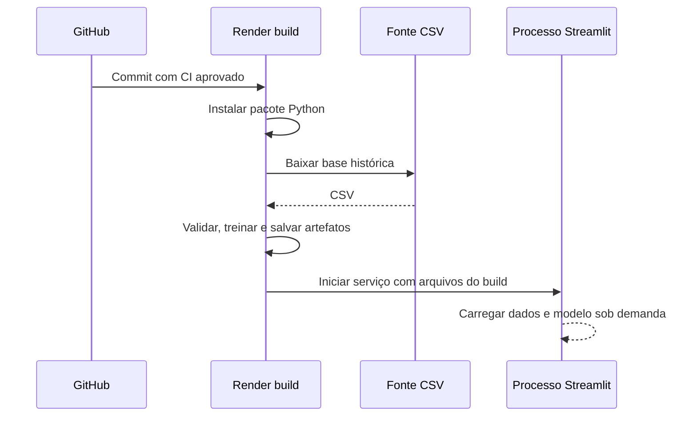

# Publicar o FlightLab no Render

**Demo publicada:** https://flightlab-dashboard.onrender.com

## Objetivo e configuração fornecida

Publicar uma demonstração que qualquer visitante do GitHub possa abrir no navegador,
sem instalar Python. O [render.yaml](../render.yaml) cria **um Web Service Python** para
o Streamlit. A API é uma publicação opcional e independente.

O dashboard chama diretamente os serviços do pacote `flightlab`; ele não depende de
um servidor FastAPI. Essa escolha reduz os componentes necessários para o portfólio.

| Item | Configuração |
| --- | --- |
| Runtime | Python, versão 3.12 definida em `.python-version` |
| Plano declarado | `free`; revise disponibilidade e limites na sua conta |
| Build | `bash scripts/render-build.sh` |
| Start | `python -m streamlit run apps/dashboard.py --server.address 0.0.0.0 --server.port $PORT --server.headless true` |
| Health check | `/_stcore/health` |
| Auto-deploy | Após os checks de CI passarem |
| LLM público | Desativado: `FLIGHTLAB_ENABLE_LLM=false` |

## 1. Publicar o código no GitHub

Os arquivos precisam estar na branch que o Render vai acompanhar. Revise o diff antes
do commit. Não inclua `.env`, CSV bruto ou `model.joblib`: eles são ignorados pelo Git.
O relatório `artifacts/metrics.json` pode ser versionado para documentar o experimento.

A configuração de CI é `.github/workflows/ci.yml`. Ela verifica lint, formatação e testes.
O badge do README apresenta o estado real desse workflow depois que ele existir no GitHub.

## 2. Criar a demonstração por Blueprint

1. Entre no [painel do Render](https://dashboard.render.com/).
2. Escolha **New → Blueprint** e conecte sua conta do GitHub.
3. Selecione o repositório `DiogoPacker/projetinho_mba` e a branch com `render.yaml`.
4. Confira o nome, plano, runtime e comandos propostos antes de criar o serviço.
5. Acompanhe os logs do build e o resultado do health check.
6. Abra a URL `onrender.com` retornada pelo Render e teste os quatro módulos.

O auto-deploy está definido como `checksPass`. Depois de alterações, o Render aguarda
os checks da branch. Se nenhum check for detectado, essa política não dispara um novo
deploy; configure o GitHub Actions ou faça um deploy manual pelo painel.

## 3. Entender o ciclo de dados e modelo



Download e treino acontecem em **cada build**, não a cada acesso nem a cada reinício
do processo web. Não é usado `preDeployCommand`, recurso com restrições por plano.
O filesystem de execução é efêmero: alterações feitas durante o uso não devem ser
tratadas como persistência. A demo não aceita upload nem retreina pelo navegador.

O build depende da disponibilidade da fonte externa e não fixa uma revisão do CSV.
O hash em `metrics.json` identifica a base usada em cada treino. Para um ambiente
reprodutível de produção, publique dados e modelos versionados em storage apropriado
e valide o hash esperado antes de servir.

## Configuração manual alternativa

Crie um **Web Service**, escolha o runtime **Python** explicitamente e use os comandos
da tabela acima. A presença de Dockerfile no repositório não obriga a usar Docker.
Defina `FLIGHTLAB_ENABLE_LLM=false` e mantenha o diretório raiz do serviço na raiz do repo.
O `.python-version` fixa a série 3.12; não é necessário definir `PYTHON_VERSION` no painel.
Se definir essa variável, o Render exige uma versão completa e ela tem precedência.

## Publicar a API opcional

Crie um segundo Web Service Python ligado ao mesmo repositório. Use o mesmo comando
de build e este comando de start:

```bash
python -m uvicorn flightlab.api:app --host 0.0.0.0 --port "$PORT"
```

Defina health check `/health` e `FLIGHTLAB_ENABLE_LLM=false`. Cada serviço gera sua
própria cópia dos dados e modelo; eles não compartilham um volume. O Swagger estará
em `/docs` na URL da API, enquanto o dashboard terá sua própria URL.
Um segundo serviço também consome recursos e cotas próprios.

## LLM e credenciais

Na demo padrão, o resumo local é suficiente para mostrar o fluxo sem cobranças.
O bloqueio é aplicado no backend: enviar `use_llm=true` à API não o contorna.

Para um ambiente com acesso controlado, configure no painel do Render:

| Variável | Uso |
| --- | --- |
| `FLIGHTLAB_ENABLE_LLM=true` | Autoriza chamadas ao provedor |
| `OPENAI_API_KEY` | Credencial secreta da conta responsável pelo consumo |
| `OPENAI_MODEL` | Modelo da API; padrão `gpt-4.1-mini` |
| `FLIGHTLAB_HOME` | Opcional: diretório absoluto que contém `data/` e `artifacts/` |

Não habilite uma chave paga em uma demonstração irrestrita: esta versão não tem
autenticação, rate limiting ou quota por visitante. Não coloque a chave no YAML,
no README ou no histórico Git. `store=False` não significa ausência de cobrança.

## Verificação depois do deploy

- O health check responde HTTP 200.
- A análise mostra 327.346 voos válidos se a fonte continuar igual ao experimento inicial.
- Filtros alteram os indicadores e os gráficos.
- O simulador retorna uma probabilidade e os avisos de limitação.
- O resumo local funciona e o LLM está desativado na demonstração pública.
- Depois de testar, coloque a URL real no campo **Website** do GitHub e no README.

## Problemas comuns

| Sintoma | O que verificar |
| --- | --- |
| Tela de carregamento ao abrir a demo | Instâncias Free suspendem após 15 minutos sem tráfego; aguarde a retomada |
| Aplicação não abre a porta | Use `0.0.0.0` e a variável `$PORT` fornecida pelo Render |
| Base ou modelo ausente | Veja se download e treino terminaram no build; confira diretório raiz e `FLIGHTLAB_HOME` |
| Falha no download | Confira HTTP/rede da fonte nos logs e tente novo build |
| Processo encerrado por memória | Reveja métricas de RAM e o plano; a capacidade gratuita não é garantia para toda carga |
| Novo commit não gerou deploy | Verifique os checks do GitHub e a política `checksPass` |
| Erro com artefato antigo | Faça novo build para treinar com as mesmas bibliotecas usadas no runtime |

A demo foi publicada pelo responsável pelo projeto no endereço acima. O consumo e a
disponibilidade dependem da conta Render. A animação do dashboard acompanha a preparação
dos dados depois que o Streamlit já está respondendo. Enquanto uma instância Free
adormecida está reiniciando, a tela inicial pertence ao Render e não pode ser substituída
pelo CSS da aplicação. Para evitar essa etapa, considere uma instância sempre ativa.

## Referências oficiais

Consultadas em 16/11/2026; políticas e limites podem mudar.

- [Blueprint YAML e campos de serviço](https://render.com/docs/blueprint-spec)
- [Deploys e integração com CI](https://render.com/docs/deploys)
- [Limitações do plano gratuito](https://render.com/docs/free)
- [Escolha da versão Python](https://render.com/docs/python-version)
- [Web Services e portas](https://render.com/docs/web-services)
